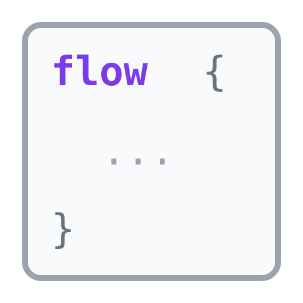

# Axial

<picture>
  <source media="(prefers-color-scheme: dark)" srcset="docs/content/img/axial-readme-dark.svg">
  <source media="(prefers-color-scheme: light)" srcset="docs/content/img/axial-readme-light.svg">
  
</picture>

Write asynchronous F# workflows whose expected failures and required dependencies are visible in their types.

[](https://github.com/adz/Axial/actions/workflows/ci.yml)
[](https://adz.github.io/Axial/)
[](https://www.nuget.org/packages/Axial)
[](LICENSE)

> [!WARNING]
> Axial is pre-1.0 and its API may change before the first stable release.

## Your first flow

A handler usually needs services and can fail, but a `Task` signature shows neither fact. `Flow<'env, 'error, 'value>`
makes both part of the contract.

```fsharp
open Axial

type CheckoutError =
    | OrderNotFound of orderId: int
    | PaymentDeclined of reason: string

type Receipt = { OrderId: int; Total: decimal; Reference: string }

type CheckoutEnv =
    { FindTotal: int -> ColdTask<Result<decimal, CheckoutError>>
      Charge: decimal -> ColdTask<Result<string, CheckoutError>> }

let checkout orderId : Flow<CheckoutEnv, CheckoutError, Receipt> =
    flow {
        let! findTotal = Flow.envWith _.FindTotal
        let! charge = Flow.envWith _.Charge
        let! total = findTotal orderId
        let! reference = charge total
        return { OrderId = orderId; Total = total; Reference = reference }
    }
```

The application supplies live functions. A test supplies a record of fakes. The workflow does not change.

Adding a timeout and a retry policy leaves the `Flow<CheckoutEnv, CheckoutError, Receipt>` signature unchanged.
The runtime supplies its clock and owns cancellation, retries, and cleanup:

```fsharp
open System

let checkoutOrder orderId : Flow<CheckoutEnv, CheckoutError, Receipt> =
    checkout orderId
    |> Flow.retry (Schedule.recurs 2)
    |> Flow.timeout (TimeSpan.FromSeconds 5.0) (PaymentDeclined "checkout timed out")
```

Flow also carries concurrency, scheduling, streams, and structured child fibers through the same runtime.
Clock, random and GUID values are scoped runtime services; application authority stays in `'env`. Use
`Flow.withClock`, `Flow.withRandom` and `Flow.withGuid` to override values for a flow and its descendants.
`Log.info` writes to the current `ILogSink` (Information+ on stderr by default); install or decorate destinations
with `Flow.withLogSink` / `Flow.mapLogSink`, and observation callbacks with `Flow.withTelemetry`.

Core `Axial` ships these runtime services under the `Axial.PlatformService` namespace. `Flow.runTest env` creates a
fresh epoch manual clock, seeded random, sequential GUIDs and a recording log. Timed tests explicitly advance
`TestClock` after observing sleeper registration; time never advances automatically. See [runtime services](docs/06-services/01-platform-services/_index.md).

## Install

```bash
dotnet add package Axial
```

## Package family

- [`Axial`](https://www.nuget.org/packages/Axial): the core workflow model: typed failures, dependencies, concurrency, resources, schedules, streams, and runtime platform services.
- [`Axial.Process`](https://www.nuget.org/packages/Axial.Process): external process composition, pipelines, streaming output, typed failures, cancellation, and cleanup. [Process docs](docs/process/_index.md)
- [`Axial.HttpClient`](https://www.nuget.org/packages/Axial.HttpClient): typed HTTP requests, response handling, and reliability policies. [HTTP docs](docs/http/_index.md)
- [`Axial.Configuration`](https://www.nuget.org/packages/Axial.Configuration): layered environment, argument, JSON, browser, and Microsoft configuration decoded by Reified, with redacted secrets. [Configuration docs](docs/configuration/_index.md)
- [`Axial.Console`](https://www.nuget.org/packages/Axial.Console): standard streams, redirection, and terminal control. [Console docs](docs/console/_index.md)
- [`Axial.FileSystem`](https://www.nuget.org/packages/Axial.FileSystem): file-system access, streaming traversal, atomic writes, and the append log. [FileSystem docs](docs/filesystem/_index.md)
- [`Axial.WebSocket`](https://www.nuget.org/packages/Axial.WebSocket): typed WebSocket client sessions and errors. [WebSocket docs](docs/websocket/_index.md)
- [`Axial.Hosting`](https://www.nuget.org/packages/Axial.Hosting), [`Axial.Hosting.AspNetCore`](https://www.nuget.org/packages/Axial.Hosting.AspNetCore), [`Axial.Hosting.GenHttp`](https://www.nuget.org/packages/Axial.Hosting.GenHttp), [`Axial.Hosting.Node`](https://www.nuget.org/packages/Axial.Hosting.Node), and [`Axial.Hosting.Browser`](https://www.nuget.org/packages/Axial.Hosting.Browser): host adapters. [Hosting docs](docs/hosting/_index.md)
- [`Axial.ElmishFlows`](https://www.nuget.org/packages/Axial.ElmishFlows): Elmish commands and subscriptions backed by workflows. [Elmish docs](docs/elmish/_index.md)
- [`Axial.Telemetry`](https://www.nuget.org/packages/Axial.Telemetry) and [`Axial.Telemetry.JavaScript`](https://www.nuget.org/packages/Axial.Telemetry.JavaScript): .NET and Fable tracing, metrics, and dumps. [Telemetry docs](docs/telemetry/_index.md)
- [`Axial.Guardrails`](https://www.nuget.org/packages/Axial.Guardrails) and [`Axial.Tool`](https://www.nuget.org/packages/Axial.Tool): effect-boundary analysis and the `axial` policy CLI. [Guardrails docs](docs/guardrails/_index.md)

See the [package maturity table](docs/15-notes/02-package-maturity.md) for each package's rating and application evidence. The [package catalogue](https://adz.github.io/Axial/packages/) links the first-class libraries and the complete compatibility matrix.

## Documentation and examples

- [Getting started](docs/01-getting-started/_index.md)
- [Add Axial to an existing Task application](docs/01-getting-started/03-existing-task-application.md)
- [Failures and defects](docs/04-error-handling/_index.md)
- [Dependencies and services](docs/05-dependencies/_index.md)
- [Concurrency](docs/08-concurrency-and-state/_index.md)
- [Process](docs/process/_index.md)
- [HTTP client](docs/http/_index.md)
- [Runnable examples](docs/13-testing/02-runnable-examples.md)
- [Integration reference application and HTTP host examples](https://github.com/adz/axial-examples)

## Reified integration

[Reified](https://github.com/adz/Reified) declares value, model, JSON, and HTTP contracts. Axial's optional server adapters execute Reified HTTP contracts as workflows; neither core depends on the other. Axial 0.12 requires Reified 0.12.1 or later, whose Fable schema builder supports typed schema construction and `Config.load` decoding on Fable.
