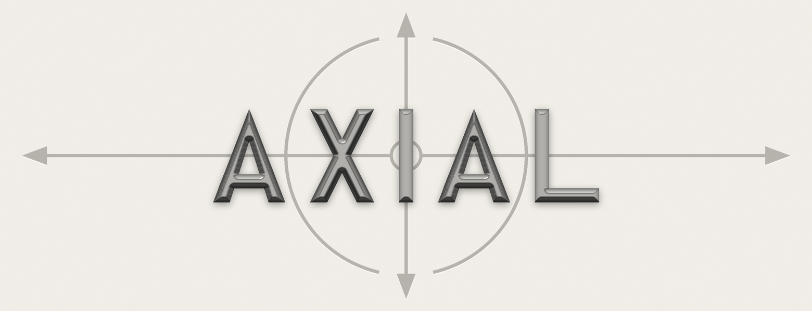
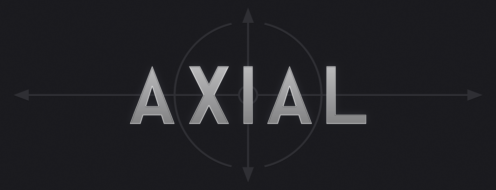

<div class="docs-home-container axial-landing">
<input type="checkbox" id="why-toggle" class="why-toggle" aria-controls="why-panels" />
<div class="docs-home-hero">
<div class="docs-home-copy">
<span class="eyebrow">Typed asynchronous workflows for F#</span>
<div class="docs-home-hero-visual">


</div>
<h1>Make the safe path the easy path.</h1>
<div class="lede">
<p><code>Flow</code> is one type for work that is async, can fail, can be cancelled, and uses services. One runtime cancels, cleans up, and retries it by the same rules everywhere.</p>
</div>
<p><a class="btn btn-primary" href="getting-started/index.html">Run your first workflow</a> <label class="btn btn-secondary why-toggle-label" for="why-toggle">Why Flow?</label></p>
</div>
</div>

<div class="why-panels" id="why-panels">

<section class="why-panel">
<div class="why-panel-head"><span class="why-number">1</span><h2>Async work and expected errors in one type</h2></div>
<p><code>let!</code> stops at the first expected error. An exception becomes a defect in the outcome instead of escaping.</p>
<div class="why-compare">
<div class="why-side why-side--before"><span class="why-side-label">Task</span>

```fsharp no-check reason="Shortened from the checked examples on the Why Flow page"
task {
    match! loadCart id with
    | Error e -> return Error e
    | Ok cart ->
        match! charge cart with
        | Error e -> return Error e
        | Ok payment ->
            return Ok(receipt cart payment)
}
```

</div>
<div class="why-side why-side--after"><span class="why-side-label">Flow</span>

```fsharp no-check reason="Shortened from the checked examples on the Why Flow page"
flow {
    let! cart = loadCart id
    let! payment = charge cart
    return receipt cart payment
}
```

</div>
</div>
<p class="why-link"><a href="error-handling/">Error handling →</a></p>
</section>

<section class="why-panel">
<div class="why-panel-head"><span class="why-number">2</span><h2>Cancellation is handled the same way everywhere</h2></div>
<p>No cancellation token to pass. If one parallel load fails, the other is interrupted. On timeout, both are, and their resources are released first.</p>
<div class="why-compare">
<div class="why-side why-side--before"><span class="why-side-label">Task</span>

```fsharp no-check reason="Shortened from the checked examples on the Why Flow page"
use cts =
    CancellationTokenSource
        .CreateLinkedTokenSource token
cts.CancelAfter(TimeSpan.FromSeconds 2.0)
let profile = loadProfile user cts.Token
let orders = loadOrders user cts.Token
// one failing does not stop the other
do! Task.WhenAll(profile :> Task, orders)
```

</div>
<div class="why-side why-side--after"><span class="why-side-label">Flow</span>

```fsharp no-check reason="Shortened from the checked examples on the Why Flow page"
Flow.zipPar
    (loadProfile user)
    (loadOrders user)
|> Flow.timeout
    (TimeSpan.FromSeconds 2.0)
    DashboardTimedOut
```

</div>
</div>
<p class="why-link"><a href="concurrency-and-state/fibers.html">Fibers and cancellation →</a></p>
</section>

<section class="why-panel">
<div class="why-panel-head"><span class="why-number">3</span><h2>Dependencies in the signature mark the boundaries</h2></div>
<p>The first type parameter names the services a flow uses. <code>reserveStock</code> reaches inventory and nothing else, and a test supplies only what the flow names.</p>
<div class="why-compare">
<div class="why-side why-side--before"><span class="why-side-label">Task</span>

```fsharp no-check reason="Shortened from the checked examples on the Why Flow page"
// Which services does it use?
// The signature does not say.
val checkout:
    Cart -> CancellationToken
    -> Task<Result<Receipt, OrderError>>
```

</div>
<div class="why-side why-side--after"><span class="why-side-label">Flow</span>

```fsharp no-check reason="Shortened from the checked examples on the Why Flow page"
val reserveStock: Cart ->
    Flow<Inventory, OrderError, Reservation>
val chargeCard: Cart ->
    Flow<Billing, OrderError, Payment>
val placeOrder: Cart ->
    Flow<Shop, OrderError, Receipt>
```

</div>
</div>
<p class="why-link"><a href="dependencies/the-environment.html">The environment →</a></p>
</section>

<section class="why-panel">
<div class="why-panel-head"><span class="why-number">4</span><h2>Time, randomness, and IDs are services too</h2></div>
<p>Reading the clock or making a GUID adds that service to the type. Production supplies live ones; a test supplies fixed ones and gets the same result every run.</p>
<div class="why-compare">
<div class="why-side why-side--before"><span class="why-side-label">Task</span>

```fsharp no-check reason="Shortened from the checked examples on the Why Flow page"
// A different result on every run,
// and nothing in the type says why.
{ Id = Guid.NewGuid()
  PlacedAt = DateTimeOffset.UtcNow }
```

</div>
<div class="why-side why-side--after"><span class="why-side-label">Flow</span>

```fsharp no-check reason="Shortened from the checked examples on the Why Flow page"
flow {
    let! placedAt = Clock.now
    let! id = Guid.newGuid
    return { Id = id; PlacedAt = placedAt }
}
// reads the runtime clock and GUID generator; no environment requirement
```

</div>
</div>
<p class="why-link"><a href="services/">Services →</a></p>
</section>

<section class="why-panel">
<div class="why-panel-head"><span class="why-number">5</span><h2>Fast underneath</h2></div>
<p>A running flow is a <code>ValueTask</code> on .NET, so work that completes synchronously avoids a heap allocation. On Fable JS it is an <code>Async</code>.</p>
<p class="why-link"><a href="the-flow-type/flow-type.html#what-runs-underneath">What runs underneath →</a></p>
</section>

<div class="why-minis">

<section class="why-panel why-mini">
<div class="why-panel-head"><span class="why-number">6</span><h2>Resources belong to their scope</h2></div>
<p>A helper opens a connection and returns it. It closes when the caller's scope ends.</p>

```fsharp no-check reason="Shortened from the checked examples on the Why Flow page"
flow {
    let! orders = connect "orders"
    let! billing = connect "billing"
    return summarise orders billing
}
|> Flow.scoped
```

<p class="why-link"><a href="the-flow-type/resources.html">Resources →</a></p>
</section>

<section class="why-panel why-mini">
<div class="why-panel-head"><span class="why-number">7</span><h2>Streams keep the same rules</h2></div>
<p>Four workers at a time. After ten pages, the rest are interrupted and released.</p>

```fsharp no-check reason="Shortened from the checked examples on the Why Flow page"
FlowStream.fromSeq pageIds
|> FlowStream.mapFlowPar
    (Parallelism.bounded 4) fetchPage
|> FlowStream.take 10
|> FlowStream.runCollect
```

<p class="why-link"><a href="streams/">Streams →</a></p>
</section>

<section class="why-panel why-mini">
<div class="why-panel-head"><span class="why-number">8</span><h2>You can see what is running</h2></div>
<p>Every fiber has an id, a parent, and a name. A registry lists the live ones.</p>

```fsharp no-check reason="Shortened from the checked examples on the Why Flow page"
poll
|> Flow.forkNamed "outbox-poller"
|> Flow.annotate "tenant" "acme"
|> Flow.withFiberRegistry registry
// registry.DumpAt(clock) lists live fibers
```

<p class="why-link"><a href="observability/">Observability →</a></p>
</section>

</div>

<section class="why-panel">
<div class="why-panel-head"><span class="why-number">9</span><h2>Fewer states to reason about, for people and for LLMs</h2></div>
<p>Every flow ends one of three ways, and concurrency follows fixed rules. Reviewers and LLM assistants have fewer cases to consider.</p>
<div class="why-outcomes" aria-label="The three ways a flow ends">
<span class="why-outcome why-outcome--value">Value</span>
<span class="why-outcome why-outcome--error">Expected error, named in the type</span>
<span class="why-outcome why-outcome--defect">Defect or interruption</span>
</div>
<ul class="why-rules">
<li>Forked work belongs to the scope that started it.</li>
<li>Cancellation always arrives as an interruption.</li>
<li>Resources are released in reverse order, however the scope ends.</li>
<li>Axial.Guardrails flags direct clock and randomness calls, exceptions in <code>flow { }</code>, and dropped cancellation tokens.</li>
</ul>
<p class="why-link"><a href="notes//guardrails/guardrails.html">Guardrails →</a></p>
</section>

<p class="why-more"><a href="getting-started/why-flow.html">Read the full Why Flow page →</a></p>

</div>

<div class="docs-home-example" aria-label="Axial dependency and runtime model">
<span class="docs-home-example-label">How it fits together</span>
<div class="axial-coord">
<div class="axial-coord-col axial-coord-col--left">
<span class="axial-coord-label">Typed environment</span>
<div class="coord-row"><span class="coord-pill">Application record</span><span class="coord-line"></span></div>
<div class="coord-row"><span class="coord-pill">Clock</span><span class="coord-line"></span></div>
<div class="coord-row"><span class="coord-pill">HTTP</span><span class="coord-line"></span></div>
<div class="coord-row"><span class="coord-pill">File system</span><span class="coord-line"></span></div>
<div class="coord-row"><span class="coord-pill">Process</span><span class="coord-line"></span></div>
<div class="coord-row"><span class="coord-pill">Your services</span><span class="coord-line"></span></div>
</div>
<div class="axial-coord-mid">
<div class="coord-hub">
<span>Flow&lt;'env, 'error, 'value&gt;</span>
</div>
</div>
<div class="axial-coord-col axial-coord-col--right">
<span class="axial-coord-label">Supplied at the edge</span>
<div class="coord-row"><span class="coord-line"></span><span class="coord-pill">Live services</span></div>
<div class="coord-row"><span class="coord-line"></span><span class="coord-pill">Test doubles</span></div>
<div class="coord-row"><span class="coord-line"></span><span class="coord-pill">.NET</span></div>
<div class="coord-row"><span class="coord-line"></span><span class="coord-pill">Browser</span></div>
<div class="coord-row"><span class="coord-line"></span><span class="coord-pill">Node</span></div>
</div>
</div>
<p class="axial-coord-caption">A flow names the environment it needs. The caller supplies it at run time.</p>
</div>

## Packages

- **[Axial](/getting-started/)**: typed async workflows with explicit dependencies, concurrency, resources, and streams.
- **[Axial.Process](/process/)**: run external commands and pipelines as flows, with streamed output and cancellation.
- **[Axial.HttpClient](/http/)**: an HTTP client with typed requests, responses, and retry policies.

[View all packages →](/packages/)

<div class="docs-home-meta">
<a class="docs-chip" href="getting-started/index.html">Documentation</a>
<a class="docs-chip" href="https://github.com/adz/Axial">GitHub</a>
<a class="docs-chip" href="https://github.com/adz/Reified">Reified</a>
</div>
</div>

<script>
(() => {
  const toggle = document.getElementById("why-toggle");
  const panels = document.getElementById("why-panels");
  if (!toggle || !panels) return;

  toggle.addEventListener("change", () => {
    if (!toggle.checked) return;
    const reduceMotion = window.matchMedia("(prefers-reduced-motion: reduce)").matches;
    requestAnimationFrame(() => {
      panels.scrollIntoView({
        behavior: reduceMotion ? "auto" : "smooth",
        block: "start"
      });
    });
  });
})();
</script>
