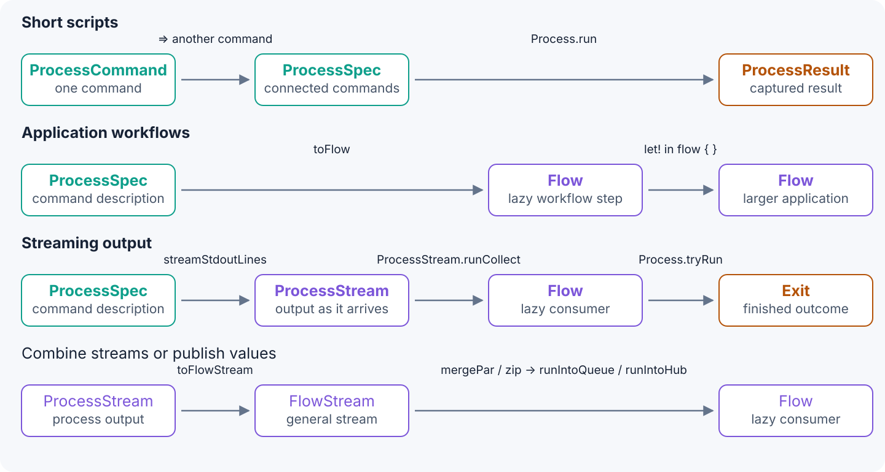
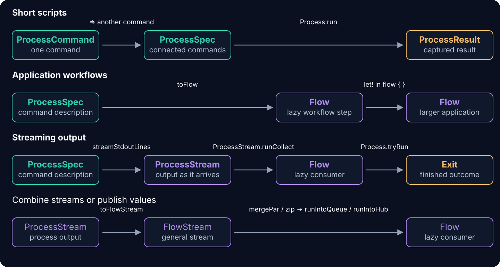

# Processes

`Axial.Process` describes external commands and connects them to Axial workflows. Use `toFlow` to make a command
one step in a larger `Flow`, alongside other application work. For short scripts, the `run` and `runExitCode`
helpers execute commands directly. Both approaches retain typed failures, cancellation, and process cleanup.

## Run one command

`Axial.Process` runs external commands — `git`, a compiler, a media tool — and returns their output, exit
code, and failures as ordinary Axial values. `Axial.Process.DSL` builds a command with `cmd`, and `run`
executes it:

```fsharp prepare
// Setup for the checked examples on this page.
open System
open Axial
open Axial.Process
open Axial.Process.DSL

/// Fails the docs test when an example's result differs from the value shown.
let shouldEqual expected actual =
    if actual <> expected then failwithf "Expected %A but got %A" expected actual

/// Unwraps a successful outcome, failing on an expected process error.
let succeeded (outcome: Exit<ProcessResult, ProcessError>) =
    match outcome with
    | Exit.Success result -> result
    | Exit.Failure cause -> failwithf "%A" cause
```

```fsharp
open Axial.Process.DSL

let status : ProcessCommand = cmd $"git status --short"
let outcome : Exit<ProcessResult, ProcessError> = status |> run
```

```fsharp run
outcome |> succeeded |> _.ExitCode |> shouldEqual 0
```

A single command is a complete program here — no `flow { }` workflow, no application to configure. `run`
hands back an `Exit`: on success a `ProcessResult` with `StdOut`, `StdErr`, and the exit code, on failure a
`Cause<ProcessError>`.

`run` is a shortcut that executes now, not a separate scripting mode. The same `ProcessCommand` becomes one
step in an application with `toFlow`, bound with `let!` inside `flow { }` and run with the enclosing `Flow`.
A one-command script grows into a workflow without being rebuilt.

## When the command needs settings

The defaults are enough for many commands. To check a different repository, `cwd` tells Git where to run.
For a status check in a script, `env "GIT_OPTIONAL_LOCKS" "0"` prevents Git from taking optional locks or
refreshing the index on disk. `timeout` gives the command a deadline so the script cannot wait indefinitely.
Use whichever settings your command needs; each returns a `ProcessCommand` and starts no process:

```fsharp
let configuredStatus (repository: string) : ProcessCommand =
    cmd $"git status --short"
    |> cwd repository
    |> env "GIT_OPTIONAL_LOCKS" "0"
    |> timeout (TimeSpan.FromSeconds 5.)
```

```fsharp run
configuredStatus "." |> run |> succeeded |> _.ExitCode |> shouldEqual 0
```

## Count status lines with a pipe

In Bash, `|` sends Git's output to `wc -l`, which counts its lines:

```bash
git status --short | wc -l
```

The DSL uses `=>` for that same pipe: Git's stdout becomes `wc`'s stdin. The example below also keeps the
repository, environment, and timeout settings from the previous command. Joining the two `ProcessCommand`
values produces a `ProcessSpec`; configure each command before its connection:

```fsharp
let countChangedPaths (repository: string) : ProcessSpec =
    cmd $"git status --short"
    |> cwd repository
    |> env "GIT_OPTIONAL_LOCKS" "0"
    |> timeout (TimeSpan.FromSeconds 5.)
    => cmd $"wc -l"
```

### Inspect the pipeline before running it

`Process.plan` returns a `ProcessPlan` without starting either command. Its `Stages` contain a
`ProcessStagePlan` for each command, including resolved settings and the input/output connections. The
transcript builds the plan, then renders its commands, connections, routes, and settings:

```fsharp transcript
> open System;;
> open Axial.Process;;
> open Axial.Process.DSL;;
> let planned () : ProcessPlan =
-     cmd $"git status --short"
-     |> cwd "/work/repository"
-     |> env "GIT_OPTIONAL_LOCKS" "0"
-     |> timeout (TimeSpan.FromSeconds 5.)
-     => cmd $"wc -l"
-     |> Process.plan;;
> planned () |> fun plan -> plan.Commands;;
val it: string list = ["git status --short"; "wc -l"]
> planned () |> fun plan -> plan.Connections;;
val it: Tuple<int,int,bool> list = [(0, 1, false)]
> planned () |> fun plan -> plan.Stages |> List.map _.StdOut;;
val it: string list = ["pipe to stages 1"; "discard"]
> planned () |> fun plan -> plan.Stages[0].WorkingDirectory;;
val it: string option = Some "/work/repository"
> planned () |> fun plan -> plan.Stages[0].Environment;;
val it: Map<string,string option> = map [("GIT_OPTIONAL_LOCKS", Some "0")]
> planned ()
- |> fun plan ->
-     plan.Stages[0].Timeout |> Option.map (fun after -> after.TotalSeconds);;
val it: float option = Some 5.0
```

`(0, 1, false)` connects stage 0's stdout to stage 1; the boolean records whether stderr is also piped.
Git's stdout feeds the pipe, so stage 0's route is `pipe to stages 1` rather than a capture; `wc` receives
that pipe and discards its output. The repository path is just part of the plan; inspecting it does not touch
that directory.

When you're ready to execute the pipeline, call `run`:

```fsharp run
let count =
    countChangedPaths "." |> run |> succeeded |> _.StdOut |> _.Trim() |> Int32.Parse
shouldEqual true (count >= 0)
```

## The same pipeline with qualified functions

The DSL is a shorter way to construct the same commands and connections. This version uses the `Process`
functions throughout and needs no DSL names or operators:

```fsharp
let countChangedPathsWithFunctions (repository: string) : ProcessSpec =
    Process.command $"git status --short"
    |> Process.workingDirectory repository
    |> Process.environment "GIT_OPTIONAL_LOCKS" "0"
    |> Process.timeout (TimeSpan.FromSeconds 5.)
    |> Process.pipe (Process.command $"wc -l")
```

```fsharp run
let viaDsl = countChangedPaths "." |> run |> succeeded |> _.StdOut
let viaFunctions =
    countChangedPathsWithFunctions "." |> Process.run |> succeeded |> _.StdOut
shouldEqual viaDsl viaFunctions
```

## Pass values as arguments

When a filename, search term, or message comes from your program, put it in an interpolation hole: `{value}`.
`cmd` and `Process.command` pass the whole value as **one native argument**. Spaces stay inside that argument;
characters such as `;`, `|`, and `$HOME` stay literal. You do not need to build shell quoting around the value.

```fsharp
let echoMessage (message: string) : ProcessCommand =
    cmd $"printf %%s {message}"
```

```fsharp run
let message = "hello world; $HOME | 'quoted'"
echoMessage message |> run |> succeeded |> _.StdOut |> shouldEqual message
```

Here `printf` receives two arguments: the format `%s` and the complete message. `%%` writes a literal `%` in an
F# interpolated string. The message's `$HOME` is not expanded, and its `|` does not create another process.

`cmd` does not invoke a shell. When you need shell syntax in the command template, choose `bash`, `sh`, or
`pwsh` explicitly; their interpolation holes still pass values separately. Use `secret value` for sensitive
arguments so plans and diagnostics show `***`. See [scripts and shell syntax](scripts.html) for checked examples.

Construction starts no child process. `toFlow` makes a command or topology one lazy workflow step.

`run` executes directly and returns the complete `Exit`; direct command execution captures full stdout.
`runExitCode` returns an integer for an entry point and defaults to visible console output without stdout capture.
Both accept commands, specs, or an already constructed Flow. Explicit capture and routing settings win.

## From command to outcome

Each box is a type of value; each arrow names the function that produces the next value.

<div class="flow-type-diagram">
. Run returns Exit directly. ToFlow returns a lazy Flow step, composed into an application Flow with let!. StreamStdoutLines returns ProcessStream, whose runCollect terminal returns a Flow; the Process.run script helper can execute that Flow and return Exit. ToFlowStream converts ProcessStream to FlowStream for merging or publishing to a queue or hub." />
. Run returns Exit directly. ToFlow returns a lazy Flow step, composed into an application Flow with let!. StreamStdoutLines returns ProcessStream, whose runCollect terminal returns a Flow; the Process.run script helper can execute that Flow and return Exit. ToFlowStream converts ProcessStream to FlowStream for merging or publishing to a queue or hub." />
</div>

For one command, skip the connection: a `ProcessCommand` also supports `run`, `toFlow`, and the stream
constructors. `toFlow` and stream constructors describe work. In scripts, `run` is the DSL name for
`Process.run`. **`Process.run` accepts a `ProcessCommand`, `ProcessSpec`, or
`Flow<ProcessHostEnvironment, 'error, 'value>` and returns `Exit`.**
The Flow overload supplies the default process host environment; for your own
application environment, use `Flow.run environment` (or `Process.runWith environment`).

A `ProcessStream` cannot be passed directly to `run`. Choose a terminal first: `ProcessStream.runCollect`
returns a Flow that collects values and completion, while `runDrain` returns a Flow that consumes output and
keeps completion. That Flow can be executed with the script helper or composed into an application.

Use `ProcessStream.toFlowStream` to combine process output with other streams using `FlowStream.mergePar`
or `zip`, or send values through `FlowStream.runIntoQueue` / `runIntoHub`. Conversion keeps process failures
and cleanup but discards successful `ProcessCompletion`. To publish values while keeping completion,
use `ProcessStream.runForEachFlow` with `Queue.offer` or `Hub.publish`.

In an application, bind `toFlow` or a stream terminal with `let!` inside `flow { }`. The enclosing workflow
runs at the application's outer boundary, using Axial's normal runner—for example, `Flow.run environment`.
A successful direct process run contains a `ProcessResult`; a successful stream collection contains the
collected values and `ProcessCompletion`.

`Flow` and `ProcessStream` are both types and modules. The modules hold their functions, such as `Flow.map`
and `ProcessStream.map`; calling a transformation produces another value of the corresponding type.

For a server, worker, or application Flow, see [run a process in an application Flow](running-in-an-application-flow.html).

## Choose how the command communicates

| Need | API | Result |
| --- | --- | --- |
| Inspect output after completion | `toFlow` or direct `run` | `ProcessResult` inside a Flow or Exit |
| Show output as it arrives | `stdoutToConsole` / `stderrToConsole` | Configured command; capture stays independent |
| React to lines before completion | `streamStdoutLines` | `ProcessStream` with completion-aware terminals |
| Send output to a file | `stdoutToFile` / `stdoutToAppendFile` | Configured command |
| Return a command-line status | `runExitCode` | Integer exit code |

Batch execution captures full stdout and a separate 64 KiB stderr tail. Streaming retains bounded 64 KiB tails.
`captureAll`, `captureTail`, and `captureNothing` affect stdout only; stderr has explicit matching helpers.
See [output capture and destinations](output-capture.html) and [streaming output](streaming.html).

## What Axial owns

The process service starts the native topology; Axial owns its lifetime. A timeout or interruption terminates every started stage, including partially started pipelines, before the enclosing Flow finishes. Expected process problems remain `ProcessError` values instead of becoming unstructured exceptions.

## Guides

- [Commands, input, and pipelines](composition.html)
- [Output capture and destinations](output-capture.html)
- [Streaming output](streaming.html)
- [Failures and transcripts](failures-and-transcripts.html)
- [Scripts and shell syntax](scripts.html)
- [DSL recipes: input, routing, fan-in, and parallel commands](dsl-recipes.html)
- [Worked examples](worked-examples.html)
- [Run a process in an application Flow](running-in-an-application-flow.html)
- [Fable](fable.html)
